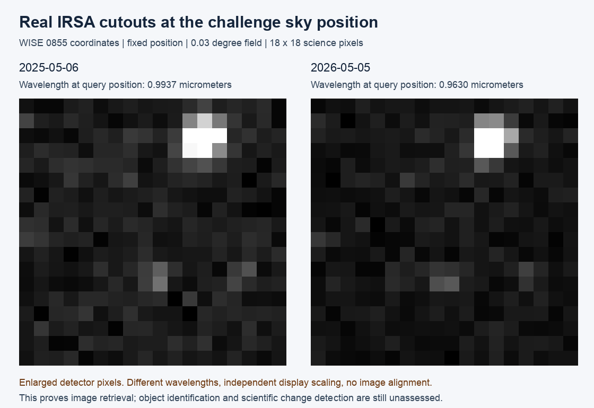

# IRSA test results — 3 November 2026

**The retrieval test worked.** We downloaded real NASA/IPAC IRSA image data around the fixed WISE 0855 coordinates supplied by the challenge, and prepared a working local backend for the team.

## In simple words

The backend can ask the archive what pictures exist for a sky location, download a small piece of a selected picture, turn the scientific file into a browser image, and return the details needed for the Change Receipt.

The next scientific step is to choose and align suitable pictures before interpreting a change. We have not identified WISE 0855 in these pictures or measured its motion.

## What came back

| Check | Observed result |
|---|---|
| Fixed search position | RA 133.7951291667°, Dec −7.2451472222° |
| Search radius | 0.01° |
| QR3 search | Successful HTTP response, 0 matching rows |
| QR2 search | Successful HTTP response, 256 image records overlapping the search circle |
| Downloaded examples | 6 May 2025 and 5 May 2026; QR2, detector D1 |
| Sky crop | 18 × 18 science pixels per image, requested field 0.03° |
| Source sizes | 5,060,160 and 5,063,040 bytes; ancillary PSF data dominate file size |
| Wavelength at query position | 0.993667 µm and 0.962969 µm |
| Browser previews | Both generated successfully from actual IMAGE pixels |
| Quality data | FLAGS and VARIANCE retained and summarized; scientific approval remains unassessed |

The different wavelengths and processing versions (v20/v24) matter: a shared detector name alone does not make two observations a fair brightness comparison. The previews also use separate display scaling and have not been registered onto a common sky grid. No difference-image or discovery claim is made.

## Backend prepared

The package includes source code, setup instructions, typed JSON Schema, OpenAPI documentation, two genuine source FITS files, previews, example API records, tests and provenance evidence.

- Search a coordinate and release: `POST /v1/searches`.
- Retrieve selected product IDs: `POST /v1/searches/{search_id}/cutouts`.
- Read observation/Change Receipt details: `GET /v1/cutouts/{cutout_id}`.
- Serve preview PNG and original FITS through generated asset routes.

Source product IDs, exact URLs, dates, wavelengths, raw quality flags, byte counts and SHA-256 hashes are preserved. The API keeps unknown measurements unknown and comparison status unassessed.

## Verification and limitations

**75 automated tests passed.** General, Python and security reviews were completed and the findings fixed. A fresh isolated installation served both example records, both PNGs and both original FITS files; source hashes matched. The real live HTTP flow also searched IRSA, retrieved one cutout and served its assets successfully.

The archive was intermittent: one repeated metadata call and an initial two-cutout HTTP batch failed at the transport layer. Those failures are saved, not counted as successful or empty searches. Two CLI downloads succeeded; a later single-cutout HTTP request succeeded. The backend returns structured errors and does not run an unlimited retry loop.

Prepared and tested locally. No deployment, team repository update, Discord message, or upload was performed. The temporary verification servers were stopped.

## Team next steps

Agree the response fields with Seerat/Husnain, select compatible wavelengths and calibration, interpret the quality masks, propagate/verify the object's position, and validate sky alignment before claiming motion or brightness changes.

## Direct sources

- [Official challenge and target coordinates](https://www.spaceappschallenge.org/2026/challenges/planet-x-and-spherex/)
- [IRSA access and SIA2](https://caltech-ipac.github.io/spherex-archive-documentation/spherex-data-access/)
- [IRSA spatial cutouts](https://irsa.ipac.caltech.edu/data/SPHEREx/docs/cutout_tool.html)
- [IRSA WCS and flag interpretation tutorial](https://caltech-ipac.github.io/irsa-tutorials/spherex-intro/)

Original query responses, hashes and retrieved metadata are retained in the package's evidence and examples folders. Kainat's SKYTRACE/Change Receipt proposal is credited in the README.
